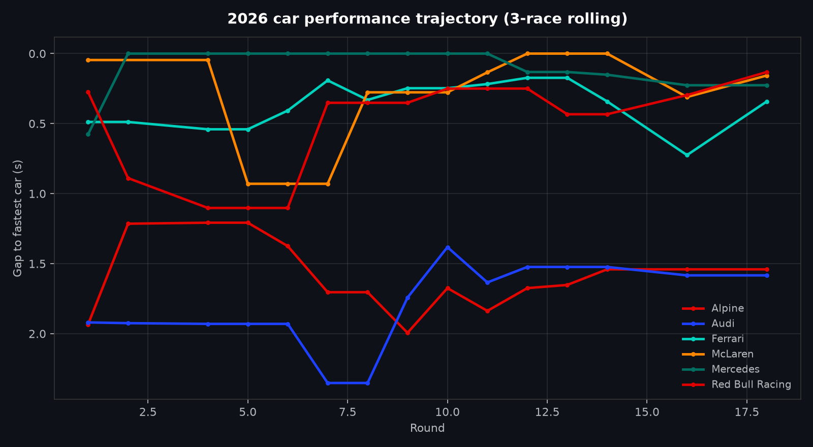
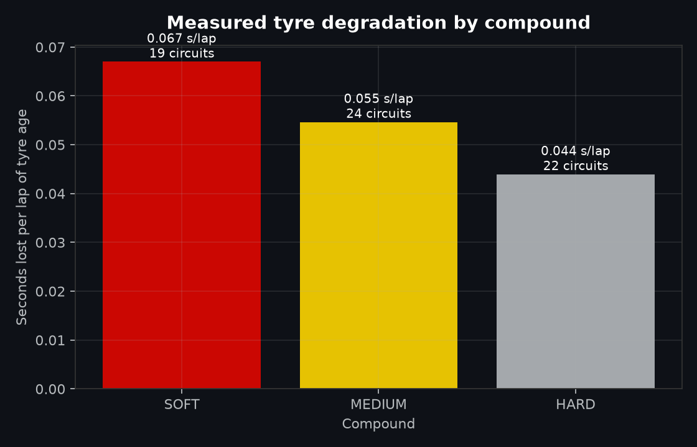
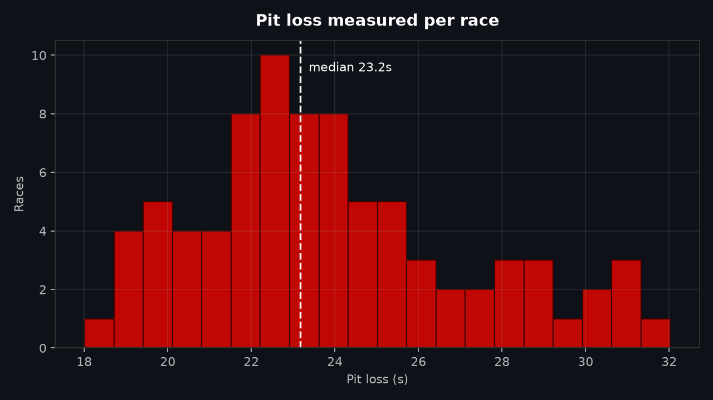
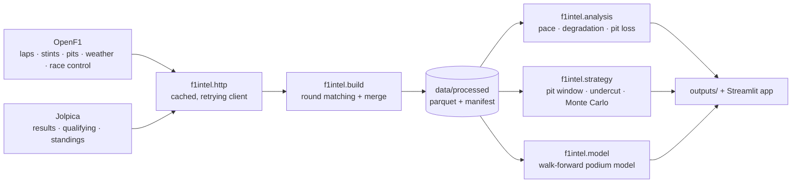
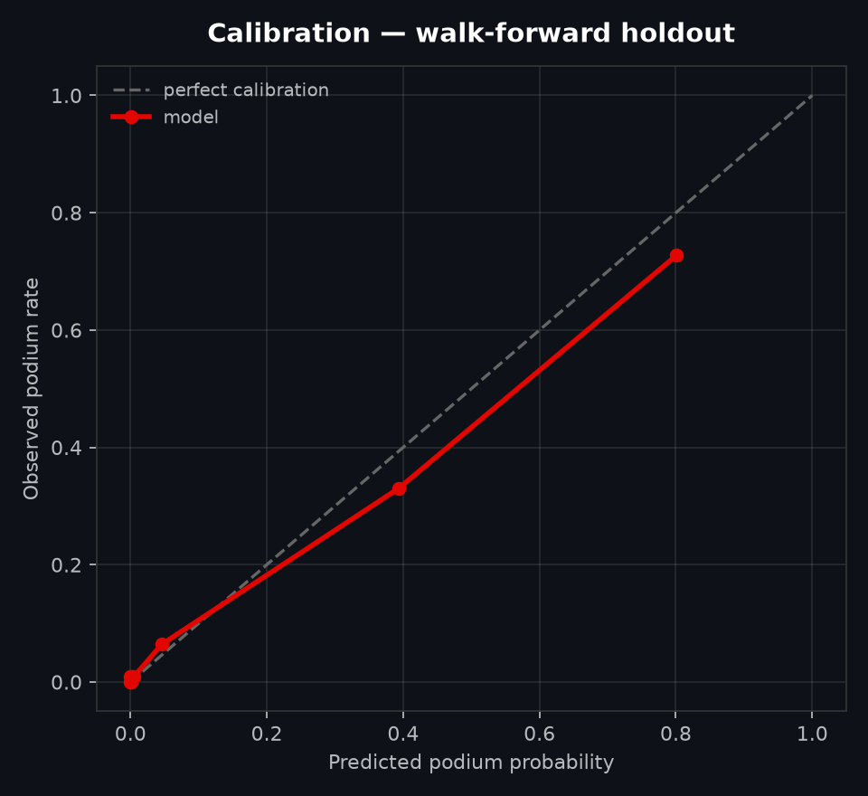

<div align="center">

# 🏎️ F1 Race Intelligence

### Race pace, tyre life and pit strategy — measured from real Formula 1 timing data

[](https://github.com/DhyeyTeraiya/f1-race-intelligence-analytics/actions)
[](https://www.python.org/)
[](https://streamlit.io/)
[](LICENSE)

**Real data · no simulated rows · every constant fitted from the timing data**

</div>

---

## What this is

An analytics project that answers the questions a race engineer actually asks:

| Question | Where the answer comes from |
| :--- | :--- |
| Which car is genuinely fastest once fuel and tyre age are removed? | Per-race lap-time model (`lap_time ~ lap_number + tyre_life + compound + driver`) |
| How does each team's development curve actually look? | Fuel/tyre-corrected pace gap, 3-race rolling median |
| What is the real pit loss at this circuit? | Measured from every stop's pit-in + pit-out laps versus the driver's clean-lap median |
| When does a compound fall off? | Degradation fitted per race and compound with fuel burn controlled |
| Is an undercut live right now? | Strategy engine using the measured pit loss and degradation, plus a Monte Carlo race simulation |
| Who is flattered by their car? | Team-mate head-to-head on corrected pace, not raw results |

Every one of those numbers is estimated from downloaded session data. **There are no
hand-tuned "typical" constants and no synthetic telemetry anywhere in this repository.**

> Version 1 of this project generated its "telemetry" with `np.random.normal()` while
> describing it as official data. That was wrong, so it was deleted. What is left is
> real, reproducible, and checked into `data/processed/` with a provenance manifest.

---

## Headline results

<!-- RESULTS-TABLE -->
| Measured from the 2023–2026 data | Value |
| :--- | :--- |
| Race weekends indexed / with lap data | **93 / 88** across four seasons |
| Driver-laps ingested | **98,095** |
| Clean green-flag laps used by the pace model | **79,224** |
| Fuel-burn coefficient (median across races) | **−0.055 s per lap** |
| Tyre degradation (median, dry compounds) | **+0.052 s per lap of tyre age** |
| Pit loss (median of **2,052** measured stops) | **23.2 s** |
| Fastest car by corrected pace | 2023 **Red Bull** · 2024 **McLaren** · 2025 **McLaren** · 2026 **Mercedes** |
| Strategy optimum | a **1-stop** is fastest at **61 of 67** modelled races |
| Podium model (walk-forward, unseen 2025 + 2026) | **0.909 accuracy · 0.944 ROC-AUC · 0.064 Brier** |

Every row above is re-derived by `python -m f1intel all`, and the provenance of the
underlying rows — counts, seasons, source URLs, build timestamp — is written to
`data/processed/manifest.json`.



*Measured tyre degradation per compound, p10–p90 across circuits:*



*Pit loss measured stop by stop — the one constant every strategy call depends on:*



---

## How it works

### 1. Ingestion (`f1intel build`)

| Source | What it provides |
| :--- | :--- |
| [OpenF1](https://openf1.org) | Lap times, sector times, tyre stints and compounds, pit-stop durations, weather, race-control messages |
| [Jolpica](https://api.jolpi.ca/ergast/f1/) | Race results, grid positions, qualifying classification, driver/constructor standings |

Sessions are matched to championship rounds by date proximity, responses are cached on
disk, and the merged dataset is written to `data/processed/` together with
`manifest.json` (row counts, seasons, source URLs, build timestamp).

### 2. Pace model (`f1intel analyze`)

For every race, using only green-flag laps with a known dry compound:

```text
lap_time ≈ β0 + β1·lap_number + β2·tyre_life + β3·compound + δ·driver
```

* `β1` absorbs fuel burn and track evolution (both linear in race distance),
* `β2` absorbs tyre degradation,
* `δ` absorbs driver pace.

Subtracting the fuel and tyre terms leaves **car pace**, which is then expressed as a
gap to the fastest car in that race. Because the same model is fitted per race, a wet
weekend or a red flag cannot contaminate another round.

### 3. Tyre and pit-loss measurement

* **Degradation** — refitted per race and compound; the reported figure is the median
  seconds lost per lap of tyre age, with p10/p90 across races so the spread is visible.
* **Pit loss** — for every recorded stop:
  `loss = pit_in_lap + pit_out_lap − 2 × driver_clean_lap_median`, filtered to a
  physically plausible 12–40 s window.

### 4. Strategy engine (`f1intel strategy`)

Fuel-adjusted lap time is reconstructed from the fitted parameters, then:

* every legal 1-stop and 2-stop plan is enumerated and ranked by projected race time;
* the undercut is simulated lap by lap against the car ahead;
* a Monte Carlo run adds lap-time noise and a randomly-timed safety car (whose
  probability is the observed share of races with a neutralised lap).

### 5. Model (`f1intel train`)

Podium classification (finish position ≤ 3) with **walk-forward validation**: for each
holdout season the model is trained only on earlier seasons. It is always compared
against a grid-position-only baseline, and reported with Brier score, log loss and a
calibration table — because accuracy alone hides badly-calibrated probabilities.

---

## Quickstart

```bash
git clone https://github.com/DhyeyTeraiya/f1-race-intelligence-analytics.git
cd f1-race-intelligence-analytics

python -m venv .venv
source .venv/bin/activate            # Windows: .venv\Scripts\activate
pip install -r requirements.txt

# Full pipeline: download -> analyse -> simulate -> model -> figures
python -m f1intel all --seasons 2023,2024,2025,2026

# Or step by step
python -m f1intel build --seasons 2024,2025
python -m f1intel analyze
python -m f1intel strategy
python -m f1intel train
python -m f1intel report

# Dashboard
streamlit run app/app.py
```

First run downloads four seasons of session JSON (about six minutes against a cold
cache); afterwards every response is served from `data/raw/cache/`, so the whole
pipeline re-runs offline in under a minute. Requires Python 3.11+.

---

## Architecture



## Repository layout

```text
f1-race-intelligence-analytics/
├── app/app.py                  # Streamlit dashboard (6 tabs)
├── src/f1intel/
│   ├── build.py                # ingestion + round matching + merge
│   ├── openf1.py, jolpica.py   # API clients
│   ├── http.py                 # cached retrying fetch layer
│   ├── analysis.py             # pace, degradation, pit loss, head-to-head
│   ├── strategy.py             # pit window, undercut, Monte Carlo
│   ├── model.py                # walk-forward podium model + calibration
│   ├── report.py               # README figures
│   └── storage.py, config.py   # persistence + settings
├── data/processed/             # committed dataset + provenance manifest
├── outputs/                    # figures, metrics, strategy summaries
├── tests/test_core.py          # 18 unit tests (no network required)
└── .github/workflows/          # CI: tests + import smoke check
```

---

## What the data is, and is not

- **Is:** laps, sector times, stints, compounds, pit durations and results downloaded
  from OpenF1 and Jolpica — independent, unofficial projects.
- **Is not:** official F1 telemetry, and not a live timing feed. OpenF1's live timing
  requires a subscription; this project works from the historical archive.
- **Is not:** simulated. The only randomness is inside the Monte Carlo *strategy*
  simulation, which is explicitly labelled as a model.
- Neutralised laps are approximated from race-control messages, so a handful of
  safety-car laps may slip through; the clean-lap filter also drops statistical outliers.
- Not affiliated with Formula 1, the FIA, or any team.

---

## Model card

<!-- MODEL-CARD -->
Target: **podium finish** (classified P1–P3). Every feature is pre-race information:
grid slot, qualifying gap and position, rolling corrected-pace gap, rolling podium rate
and rolling average finish (both shifted one race back, so the current race never leaks),
round number, street-circuit flag and race length.

| Holdout season | Trained on | Accuracy | ROC-AUC | Brier | Grid-only baseline AUC |
| :--- | :--- | ---: | ---: | ---: | ---: |
| 2025 | 2023–2024 | 0.900 | 0.929 | 0.070 | **0.930** |
| 2026 | 2023–2025 | 0.919 | 0.961 | 0.057 | 0.939 |
| **Pooled** | — | **0.909** | **0.944** | **0.064** | — |

Read the 2025 row honestly: **on that season the engineered features do not beat grid
position on ROC-AUC** (0.929 against the baseline's 0.930). Grid slot is an extremely
strong prior, and a model that only matches it is not worth shipping. What the model does
add is recall on midfield podium chances — 0.75 against the baseline's 0.56 — and better
calibration at the top of the probability range. In 2026 the features do add real signal
(0.961 against 0.939). This is reported as found, not as hoped.



---

## Limitations

- DRS trains, dirty air and traffic are not modelled; corrected pace assumes clean air.
- The strategy engine optimises a single car in isolation — it does not react to rivals'
  stops beyond the undercut calculation.
- Tyre compounds are treated as having a constant per-lap cost; real tyres have a cliff.
- Safety-car probability is a single observed rate, not track-specific.
- Race-control parsing can miss unusual neutralisation sequences.

## Roadmap

- Track-specific safety-car and red-flag rates
- Tyre "cliff" detection from stint curvature instead of a linear slope
- Live session mode against the OpenF1 live endpoints (subscription permitting)
- Traffic-aware race simulation using interval data

---

## Author

**Dhyey Teraiya** — Data Scientist

- GitHub: [@DhyeyTeraiya](https://github.com/DhyeyTeraiya)
- LinkedIn: [dhyey-teraiya](https://www.linkedin.com/in/dhyey-teraiya/)
- Email: [dhyeyteraiya@gmail.com](mailto:dhyeyteraiya@gmail.com)

## License

MIT — see [LICENSE](LICENSE). Contributions welcome; see [CONTRIBUTING.md](CONTRIBUTING.md).
